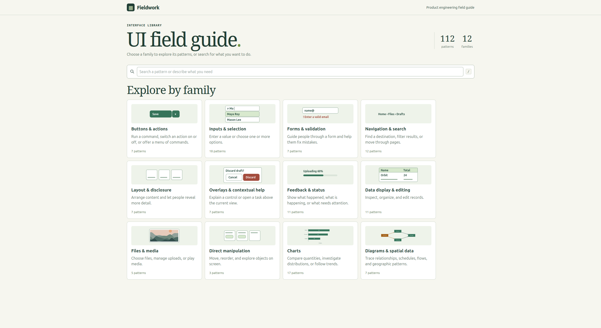
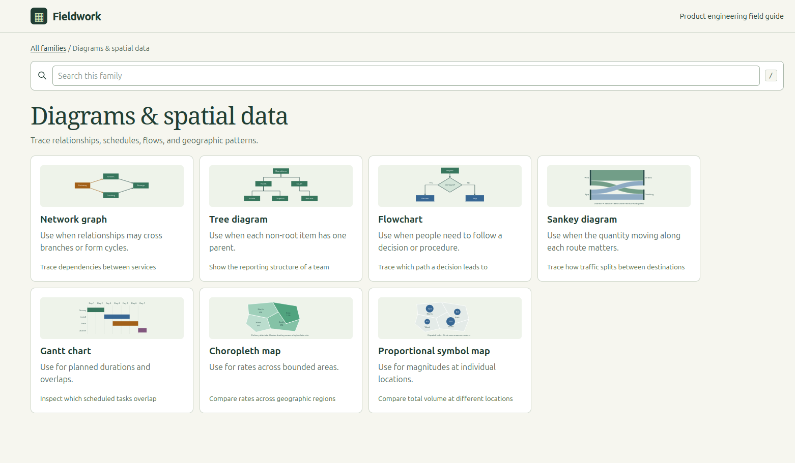
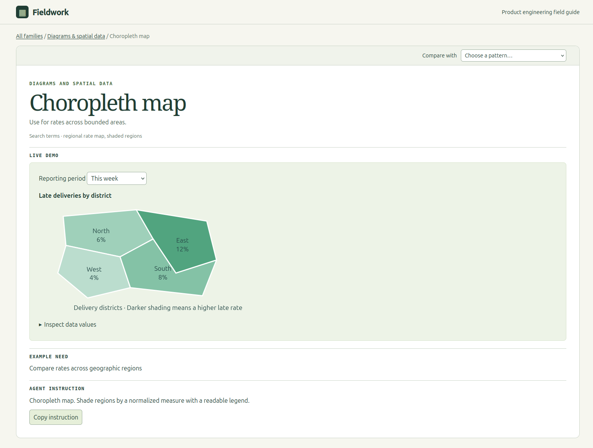

# Fieldwork · UI field guide

Open [index.html](index.html) directly in a modern browser. All demos, charts and media are bundled. To serve locally, run `python3 -m http.server 8000` here and visit `http://localhost:8000`.

Search for a pattern name or describe a need, such as “pick a customer by email”. Browse all 12 families on the home page, open a family to see when to choose each element, then try its demo or select **Compare with** to operate two patterns independently. Each entry has a reusable instruction and a shareable URL fragment. Search uses locally ranked names, aliases, examples, and descriptions.

## Quick guide

1. **Choose a family.** Open the home page to see all 12 families and visual previews.
2. **Explore button choices.** Open **Buttons & actions → Button** to compare primary, secondary, destructive, icon-only, toggle, and split buttons.
3. **Try a selector.** Open **Inputs & selection → Searchable combobox**. Type `Sam`, press the down arrow, and press Enter to select a match.
4. **Compare patterns.** Use **Compare with** to place another pattern beside the current demo and try both.
5. **Explore charts.** Open **Charts**, choose a chart, change its reporting period, and expand **Inspect data values**.
6. **Reuse the vocabulary.** Copy the agent instruction into your own prompt.
7. **Search quickly.** Press `/` to focus search. Partial keywords work from three characters, such as `kan` for Kanban board.

## Usage guide

Start on the home page. Browse the 12 UI families and scan their visual previews.

Open a family to see its elements, when to use them, and how their visual patterns differ.

Choose an element to explore its live demo, example need, and reusable agent instruction.

## Coverage

The guide includes 112 registered demos across 12 families, including 24 charts, diagrams and maps. The [coverage plan](docs/superpowers/plans/2026-11-19-ui-pattern-coverage.md) tracks learning and usability acceptance separately from implementation.

## Maintenance

- `catalog.js` holds stable IDs, terms, business needs, guidance, reusable instructions and related entries.
- `search.js` ranks entries. `app.js` connects search, comparison, deep links and demo mounting.
- `demos/controls.js`, `demos/workspace.js` and `demos/charts.js` register self-contained renderers under the catalog names.
- Run `node --test` to check checklist coverage, registration, related IDs, canonical search, filtering, and the independent query fixture. The 24 queries are a regression set after tuning, rather than an estimate of accuracy on new queries.
- With the local server running, open [browser checks](http://localhost:8000/tests/browser.html) to exercise all 112 mounts and the search, comparison and keyboard selection flows in a real browser.
